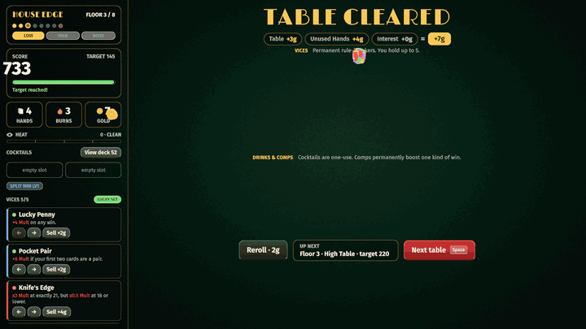
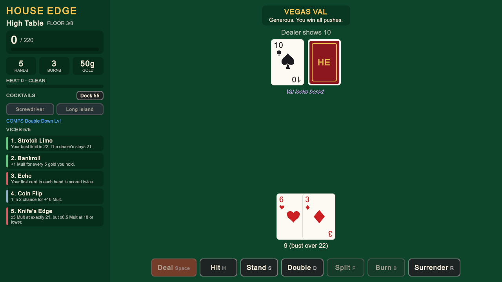
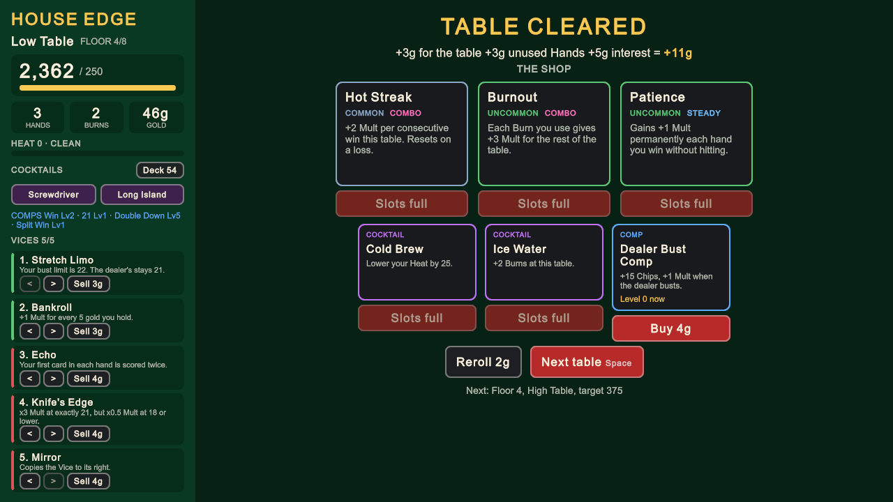
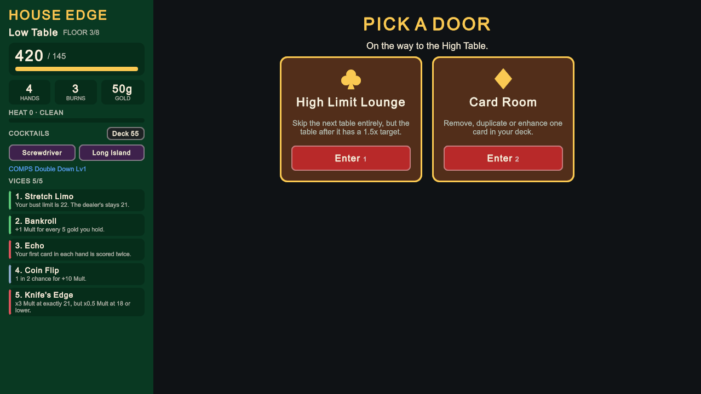
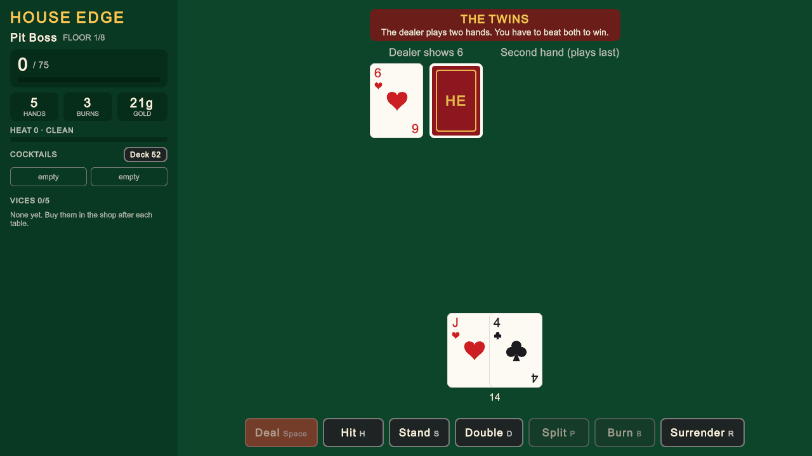

# House Edge

A blackjack roguelike deckbuilder made in Unity 6. You climb a cursed casino one floor at a time. Every table is a game
of blackjack against a score target, but you build the deck, collect Vices that bend the rules, cheat when you can get
away with it, and chase huge Chips x Mult combos. Beat The House on floor 8 to win the run.

The twist: **the dealer draws from your deck too.** Stack it with 10s and you hit 20 more often, but so does the dealer.



**Play in the browser:** _coming soon on itch.io_ <!-- TODO: replace with https://<user>.itch.io/house-edge -->

| A floor-3 High Table | The shop |
| -------------------- | -------- |
|  |  |
| **Pick your path on the floor map** | **The Purist, a Pit Boss** |
|  |  |

## Highlights

- **Engine-free, deterministic rules.** Every rule lives in `HouseEdge.Core`, a plain C# assembly with no UnityEngine
  reference. One seeded RNG drives a whole run, so a run is just a seed plus a list of inputs: run codes, the Daily Run
  and full replays all come from that. **285 NUnit tests** run on plain `dotnet test` in CI, no Unity license needed.
- **Pit Bosses are characters.** Each has a portrait drawn in code, a title, a line, one named ability in plain words
  and a tip, shown in an entrance before their table. Bosses announce their ability when it fires ("Swaps your 7 for
  his Q") through `Table.Announce`, so the rule is never invisible.
- **Effects are small classes on hooks.** 65 Vices, 15 bosses, 6 dealers, 7 enhancements, 4 stamps and 4 curse cards
  each override only the hooks they need (`OnCardDrawn`, `OnHit`, `OnStand`, `OnBust`, `OnHandScored`, ...). Adding a
  new one never touches the table's loop.
- **Balance tuned with a bot.** A headless bot plays the real `Run` API: 1,000 full runs in about a second. It showed
  the first draft of the design couldn't be won and why, and drove every number change (see [Balance](#balance)).
- **Everything from the design doc:** 8 floors with a floor map of 8 room types, 12 Pit Bosses plus The Eye in the Sky,
  The Enforcer and a 3-phase House, Heat and casino security, side bets, Cocktails, Comps, archetype set bonuses,
  6 starting decks, 6 stakes, unlocks, the Daily Run, run codes and Endless.
- **Built entirely in code.** One bootstrap method builds the camera, a UI Toolkit interface, and synthesized sound and music.
  Cards, suits, icons, poker chips and the table's felt are drawn in code (`Painter2D` vector shapes and generated
  textures, so they work on WebGL with no font fallback). The only assets are two open-source fonts.
- **Balatro-style scoring playback.** The dealer draws one card at a time, then each hand scores beat by beat: your
  cards count in, every Vice, Comp and card upgrade that fires shows its "+4 Mult" or "x3 Mult" where it came from, the
  Chips and Mult boxes tick up with a rising pitch, and the total lands in the score. Core records each step
  (`HandScore.Steps`), so the playback is the real calculation, not a guess. 1x/2x/4x speed, and a click skips it.
- **A Slay the Spire–style floor map.** Between tables, Shops and rooms sit on branching paths across three lanes
  (`FloorMap`, generated from the run's seed so replays still match). You see the whole floor and plan a route; paths
  never cross, the first row after a table always has a Shop, and the lounge only appears right before a table. The bot
  plans paths too, and the win rate held at about 21%.
- **Game feel.** Cards fly out of the shoe and the dealer's hole card flips over. Each result is acted out: winning
  cards hop and glow while the chips slide over to you, losing cards slump, busts tumble off the felt, and scoring
  hands pop a Chips x Mult breakdown over a turning sunburst. Losing the run rains cards and a sad trombone; winning it
  sets off fireworks.
- **Music made in code.** Three loops (lounge jazz between tables, a brisk minor swing at the tables, a driving
  minor-key track for Pit Bosses and security) are synthesized from walking bass, FM electric piano, vibraphone and
  drums, and crossfade as you move through the casino. On your last Hand the band speeds up and a heartbeat comes in. Every control explains itself on hover: UI Toolkit's own tooltips only show in the editor, so the game has
  a small tooltip system of its own.

**Tech:** Unity 6.6 · C# · URP 2D · UI Toolkit · Input System · NUnit · WebGL · GitHub Actions

## How to play

Each **table**: reach the target score before your 7 Hands run out. Win and you're paid gold. Run out of Hands and the
run is over. Each floor is a Low Table, two stops on a branching map, a High Table, two more stops, then a Pit Boss
with a twist and a shop. The stops are Shops and rooms laid out like Slay the Spire: you see the whole floor, start in
any lane, and follow the paths forward, so you plan where your gold goes.

**Score = Chips x Mult.** Chips start as your card total plus the outcome's base Chips; Mult starts as the outcome's
Mult. Vices, card enhancements and Comps add to both, left to right.

| Outcome | Base Chips | Base Mult |
| ------- | ---------: | --------: |
| Win | 10 | 2 |
| 21 (3+ cards) | 20 | 3 |
| Blackjack | 30 | 4 |
| Five-card Charlie | 40 | 4 |
| Dealer Bust | +15 | +0 |
| Push | cards only | 1 |

- **Burn** throws away the card you just hit and draws again (even a bust). Burns reset every table.
- **Vices** (5 slots) are passive rule-breakers. Hold 3 of one archetype (Lucky, Risky, Cheater, Greedy, Steady, Combo)
  for a set bonus.
- **Heat:** Cheater Vices and huge hands draw attention. At 100, security drags you to The Eye in the Sky.
- **Rooms:** The Bar, Back Room (double or nothing), Pawn Shop, Loan Shark, Card Room, Lost and Found, Security
  Office, High Limit Lounge.

The full design is in [DESIGN.md](DESIGN.md). Rules it doesn't spell out are in [docs/DECISIONS.md](docs/DECISIONS.md).

## Controls

| Input | Action |
| ----- | ------ |
| `Space` | Deal, leave the shop or room, start a new run |
| `H` / `S` | Hit / Stand (or let the dealer draw / make him stand with Cold Read) |
| `D` / `P` / `B` / `R` | Double Down / Split / Burn / Surrender |
| `I` / `N` | Take / decline insurance |
| `W` | Swap with the dealer (Card Mechanic Vice) |
| `1` / `2` / `3` | Pick the next stop on the map |
| `Tab` | The map |
| Click / `Space` during scoring | Skip the playback |
| `M` | Mute music and sounds |
| `Esc` | Menu (pauses) |
| Mouse | Everything else: side bets, shop, Vices, Cocktails, the deck view |

## Architecture

```
Assets/
  Scripts/
    Core/    HouseEdge.Core   - rules only, noEngineReferences: true
      Table.cs        one blackjack table: a state machine driven by LegalActions() / Apply(action)
      Run.cs          8 floors: tables, shop, floor map, rooms, debt, Heat, bosses. Apply(RunInput)
      TableEffect.cs  the hooks. Vices, bosses, dealers and card effects all derive from it
      Vices/          65 Vices, one small class each; ViceCatalog lists them
      CardEffects.cs  enhancements, stamps and curses, run card by card before the Vices
      Balance.cs      every tunable number
      BalanceBot.cs   the bot and BalanceSimulation
    Game/    HouseEdge.Game   - GameBootstrap, UI Toolkit views, input, Feedback (sound, particles, juice)
      Ui.cs           fonts, colors, buttons, tweens, keyword coloring and the tooltip system
      Visuals.cs      Painter2D poker chips, felt markings, the menu backdrop and particles
    Editor/  HouseEdge.Editor - command-line builds
  Tests/
    EditMode/ HouseEdge.Tests - NUnit tests for Core
Tools/
  CoreTests/  compiles Core + the tests for plain `dotnet test` (what CI runs)
  BalanceSim/ console runner for the balance simulation
```

- **The UI never changes game state.** Views read `Run`/`Table` and turn clicks and keys into `RunInput`s; `Run.Apply`
  checks they're legal. That's what makes replays exact: the same seed and inputs rebuild the same run.
- **Determinism:** Core never touches `UnityEngine.Random`, `System.Random`, `DateTime` or hash-order iteration. Its own
  `GameRandom` (xorshift seeded by splitmix) is passed through everything. The Daily Run's date comes in from the game.
- **Effects:** a table builds its effect list once: card rules, Comps, boss, dealer, stake rules, then your Vices in
  order. Each hook runs over that list, so trigger order is just list order.

## Balance

DESIGN.md's targets were "a starting point to tune with the balance bot". `BalanceBot` plays close to basic strategy
(and uses X-Ray Specs, Card Counter and Card Mechanic when it has them), buys Vices and Comps while keeping an interest
reserve, and plans a route across each floor's map. `Tools/BalanceSim` runs it over many seeds and reports, per table,
how often it's beaten, how many deals it took and how far past the target the score went, plus every Pit Boss's record.

What it found, in order:

1. **The draft targets couldn't be won.** Starting at 150 and doubling every floor, the bot won **0%**.
2. **Then the game was too easy, table by table.** After the first fix, tables were cleared in about 2 deals with
   the score 2-9x the target: your first winning hand usually ended the table. Players felt it before the numbers did.
3. **Blackjack scoring is lumpy.** About half of all hands score 0, so raising targets alone turned tables into coin
   flips (the bot fell to 2%). The fix was **7 Hands with targets that need ~3 good hands**, so a table is a series of
   decisions and luck evens out. Targets now roughly double every floor, like Balatro's antes.
4. **Bosses were uneven** (beaten 79-95%). Each boss's target is now scaled to its rule, so all 13 sit at 83-91%.

Research targets: Slay the Spire 2's reported overall win rate is about 25%, and 16% at its base difficulty. The bot
now wins **about 14%** (13.4% on seeds 1-1000, 14.4% on 5001-6000) and a player who builds well should do better.
Floors 1-2 are forgiving (97-99% of tables) and every Pit Boss is a spike.

| Floor | Low win | High win | Boss win | Runs reaching | Deals to clear a table |
| ----: | ------: | -------: | -------: | ------------: | ---------------------: |
| 1 | 98% | 99% | 94% | 100% | 2.4-2.7 |
| 2 | 99% | 97% | 88% | 91% | 2.3-3.0 |
| 3 | 95% | 95% | 89% | 77% | 2.7-3.2 |
| 4 | 95% | 93% | 87% | 62% | 2.6-3.2 |
| 5 | 95% | 91% | 83% | 48% | 2.7-3.1 |
| 6 | 94% | 94% | 81% | 34% | 2.6-3.3 |
| 7 | 94% | 92% | 82% | 24% | 2.5-3.5 |
| 8 | 95% | 91% | 89% (The House) | 17% | 2.6-4.1 |

Focusing the bot on one archetype shows the next thing to tune: Risky 21.6%, Steady 16.6%, Greedy 11.1%, Combo 7.7%,
Lucky 6.7%, Cheater 2.3%. Cheater builds trail because Heat sends you to security and the bot can't read tells.
A test (`TunedBalance_KeepsTheBotNearItsTargetWinRate`) runs 300 seeded runs and fails if the bot's win rate leaves
7-25%, so CI catches balance regressions.

### Running the simulation

With any .NET 8 SDK (Unity ships one at `Unity.app/Contents/Resources/Scripting/DotNetSdk/dotnet`):

```sh
cd Tools/BalanceSim
dotnet run -c Release -- 1000 1              # runs, first seed
dotnet run -c Release -- 1000 1 archetypes   # plus one batch per archetype focus
```

## Running

Open the project in **Unity 6000.6.5f1** and press Play in any scene; the bootstrap builds the game.

## Tests

Without Unity (about a second, any .NET 8 SDK):

```sh
dotnet test Tools/CoreTests
```

In the editor: **Window > General > Test Runner > EditMode > Run All**. From the command line (editor closed):

```sh
/Applications/Unity/Hub/Editor/6000.6.5f1/Unity.app/Contents/MacOS/Unity \
  -batchmode -nographics -projectPath . -runTests -testPlatform EditMode -testResults results.xml
```

## Building

```sh
Unity -batchmode -quit -projectPath . -executeMethod HouseEdge.Editor.BuildScript.WebGL   # Builds/WebGL
Unity -batchmode -quit -projectPath . -executeMethod HouseEdge.Editor.BuildScript.MacOS   # Builds/macOS
```

The WebGL build is Brotli-compressed with the decompression fallback on, so it runs on any static host (itch.io
included). For itch.io, zip the contents of `Builds/WebGL` with `index.html` at the top level and upload it as an
HTML game. A 960x600 embed matches the default canvas.

A built player also takes `-seed N -play Deal,Stand,... -capture shot.png`, which plays scripted steps, saves a
screenshot and quits (`Bot:N` lets the balance bot play N whole runs through the real UI as a smoke test).

## CI

`.github/workflows/ci.yml` runs `dotnet test Tools/CoreTests` on every push and pull request.

## Credits

Cards, suits, icons, UI, sounds and music are generated in code. Fonts: [Limelight](https://fonts.google.com/specimen/Limelight)
by Sorkin Type and [Fira Sans](https://fonts.google.com/specimen/Fira+Sans) by Mozilla, both under the
SIL Open Font License (license files in `Assets/Resources/Fonts`).
